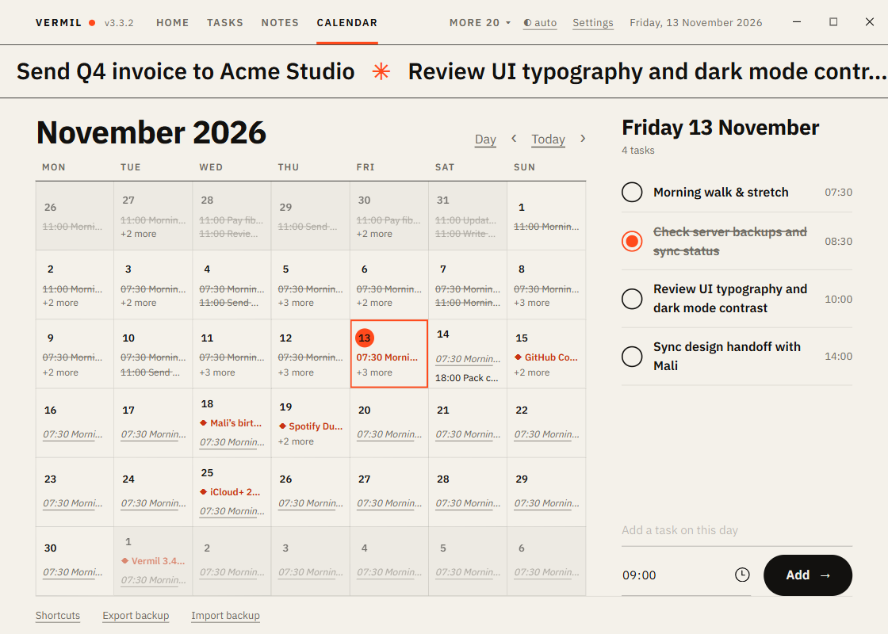
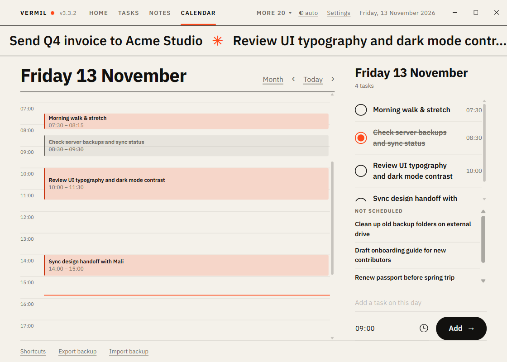

# Calendar

Your tasks by their due date, as a month or hour by hour. Needs [Tasks](Tasks.md).

## Month view

A month grid with the tasks of each day (the first few, then "+N more"). Today is marked; late tasks are accented, finished ones struck through. Click a day (or use the arrows) to select it; the list on the right shows that day's tasks.

- Tick a task in the day list to finish it; click its name to open it in Tasks.
- **Add a task on this day** at the bottom of the day panel: a title and a time.
- **Drag a task** (from a day cell or the day list) onto another day to move it. The time of day stays and any snooze is cleared. `Esc` cancels while dragging. `Ctrl+Z` in Tasks undoes it.

## Day view: time blocking

Press **Day** (or `D`, or double-click a day) to see the selected day hour by hour.

- Each task is a **block** at its time. Its length is an hour unless you change it. Blocks that overlap share the width. A line marks the current time.
- **Drag a block** up or down to move it (15-minute steps). **Drag its bottom edge** to resize.
- **Plan the day:** the right column has **Not scheduled** (tasks with no date). Drag one onto the timeline to give it a day and time. You can also drag a task from the day list onto the timeline.
- **Cancel a schedule:** drag a block from the timeline onto the right column; it highlights, and when you let go the task has no day or time any more (its length is kept for next time).
- Finished tasks show but cannot be dragged.

Keyboard: `Alt+↑` / `Alt+↓` on a focused block moves it 15 minutes; add `Shift` to resize it.

## Keys

| Key | Does |
|---|---|
| `←` `→` | Previous or next day |
| `↑` `↓` | Previous or next week |
| `PageUp` `PageDown` | Previous or next month |
| `T` | Today |
| `Enter` or `N` | Add a task on this day |
| `D` / `M` | Day view / month view |
| `Alt` + arrows on a task in the day list | Move it a day or a week |

## Repeating tasks

A repeating task is shown on **every day it comes back**, not only on its next due day: in the month cells (in italics), in the day list and on the timeline (dashed). Those later days are previews: you cannot tick or drag them. Open one to go to the real task. They start today and follow its rule: every day, weekdays, the same weekday each week, or the same date each month.

## Countdown events

With [Countdown](Countdown.md) on, its events appear in the calendar as **◆ reminders**: in the month cells, and in the day list beside the day (with "Countdown" or "Every year"). A yearly event, such as a birthday, shows every year. A reminder is not a task: you cannot tick or drag it, and clicking it opens Countdown. The hour-by-hour view lists them beside the timeline. Switching Countdown off removes them.

## Subscription renewals

With [Subscriptions](Subscriptions.md) on, every charge day is a **◆ reminder** too, with the amount ("Netflix 419"), repeating by its cycle from its next charge on. The notification a few days before is unchanged. Clicking one opens Subscriptions.
