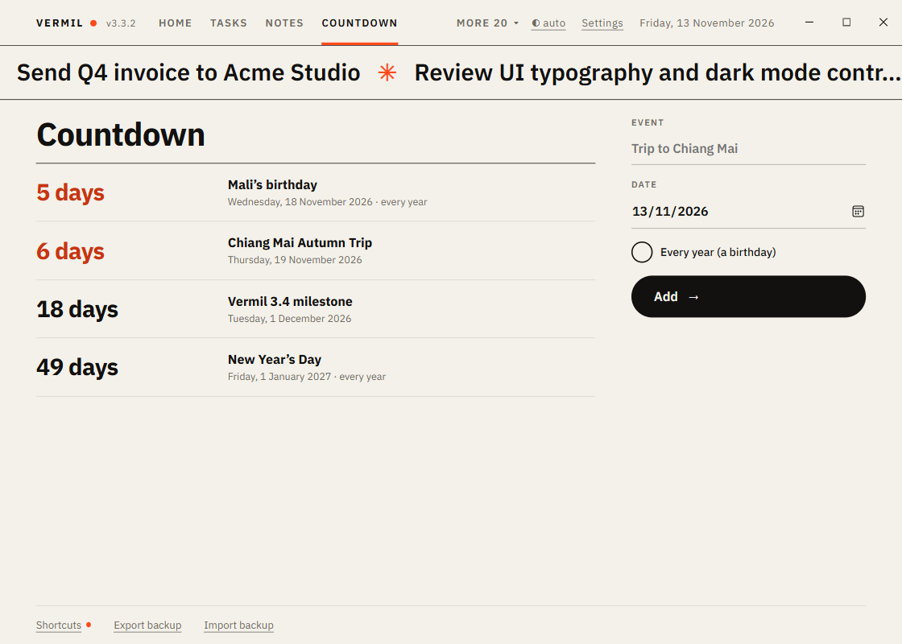

# Countdown

Days until what matters: a trip, an exam, a birthday that comes back every year.

## Add an event

On the right: the **Event**, its **Date**, and tick **Every year (a birthday)** if it repeats. A yearly event always counts to its next occurrence (29 February falls on 28 February in other years).

## The list

Soonest first: **Today**, **Tomorrow**, **12 days**. Within a week the number is accented. One-off events that have passed go last ("10 days ago", most recent first) in a quieter style. ✕ removes an event (it asks).

A notification appears **on the day** of each event, once.

Key: `N` new event. Home shows the nearest event; [Weekly Review](Weekly-Review.md) lists the next two weeks.

Tip: for people's birthdays with gift ideas and a reminder to stay in touch, use [People](People.md).
