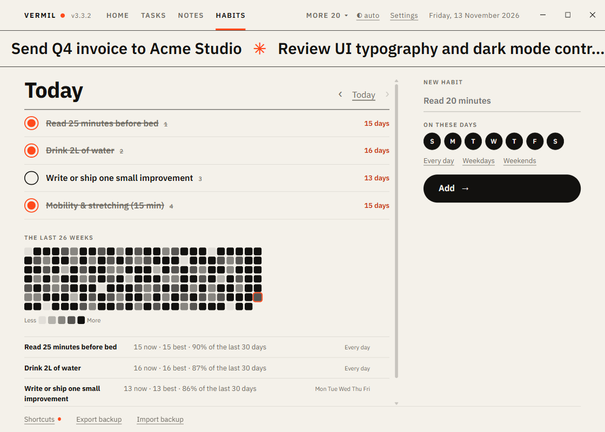

# Habits

Daily habits with streaks and a year-at-a-glance heatmap.

## Add a habit

On the right: a name ("Read 20 minutes"), the **days** it is due (tap the seven circles, or use **Every day**, **Weekdays**, **Weekends**), then **Add**. A habit counts from the day you create it.

## Tick them off

The big list shows the habits due on the chosen day. Tick the box when you did it; the number beside it counts the **days in a row** (only the days it was due count, and today not yet ticked does not break a streak).

- **Missed yesterday?** `‹` goes to earlier days so you can tick or untick them. `Today` comes back. You cannot tick the future.
- `1` to `9` ticks the numbered habit from the keyboard.

## Heatmap and numbers

**The last 26 weeks**: one square per day, darker the more of that day's habits you did, today outlined. Click a day to open it. Under it, each habit's **streak now**, **best streak**, and **rate over the last 30 days**; **✕** deletes a habit and its history (it asks).

## Keys

`←` `→` day, `T` today, `N` new habit, `1`–`9` tick.

Works with: Home tile (done of due today), [Goals](Goals.md) (habits kept in the last 7 days), [Weekly Review](Weekly-Review.md) (percent kept and the longest streak).
