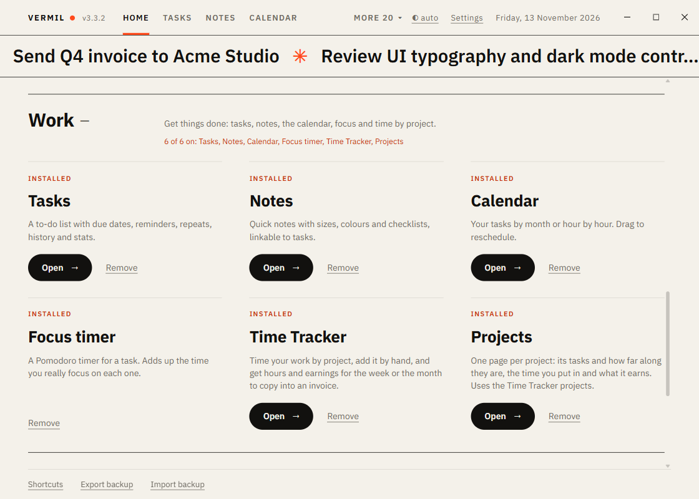

# Home, backup and sync

Home is the first page every time you open Vermil (or the last tab, if you chose that in [Settings](Settings.md)). `Ctrl+0` brings you back to it. **Backup and sync** are in Settings, under Data (`Ctrl+,`); everything below about them is unchanged.

## Modules

Every tool is a module with a card on Home. The cards sit in five **packages**: Work, Money, Life, Plan and Smart. Each package is one row that says how many of its modules are on and which; click it (or focus it and press `Enter`) to open it and see the cards, and it stays open until you close it. **Add all** on the row switches on every module of that package at once.

- **Add** switches a module on. Some need another one (Calendar needs Tasks); adding it brings what it needs.
- **Open** goes to its tab. **Remove** switches it off; if other modules need it, Vermil asks first. **Your data always stays**, so adding it again brings everything back.
- A module that is off is not loaded at all, which is what keeps Vermil light.
- If you already had tasks or notes before modules existed, Tasks, Notes and Calendar are on for you.

When you have many modules on, the tab bar shows the tabs that fit and puts the rest in a **More** menu. `Ctrl+1` to `Ctrl+9` go to the tabs in the order you set, even the ones in the menu.

## Today strip

Above the cards, one tile per module that has something to say today: open and overdue tasks, focus minutes, spending, your stocks, renewals, habits done, and so on. Click a tile to open that module. The same tiles are what the [Today widget](Today-widget.md) shows.

## Backup

A copy of **all** your data (tasks, notes and every module) once a week, keeping the newest eight, in `Documents\Vermil Backups` or any folder you type (a OneDrive folder, a USB drive).

- On by default. The checkbox turns it off.
- **Back up now** writes one immediately and says where.
- If the folder is not there (a drive that is unplugged) it tries again at the next pass instead of skipping the week.
- Only files named `vermil-backup-YYYY-MM-DD.json` are ever deleted.

The footer also has **Export backup** (a file in Downloads) and **Import backup**, which merges a backup into what you have and never deletes anything.

## Sync between computers

Keep two computers in step without an account or a server: put the **same folder** on both (inside OneDrive, Dropbox, or on a USB drive) in the Folder box.

- Vermil writes one file, `Vermil-sync.json`, with all your data. A change on one computer is saved there; the other computer takes it when it has no changes of its own (its window reloads once).
- If **both** computers changed things since they last matched, Vermil stops and tells you. Choose **Keep this computer's** or **Take the other's**. Nothing is overwritten without your choice.
- Before this computer's data is replaced it is copied to `todos.pre-sync.json` in the data folder.
- A computer with nothing yet simply takes what is in the folder.
- If the file cannot be read (still downloading) or is not a Vermil file, you get an error and nothing changes.

Tip: let your sync service finish before opening Vermil on the other computer.

## Other settings (footer)

- **Start with Windows**, **Morning summary at** (a notification once a day with what is due), **Shortcuts**.
- The theme button in the top bar: auto, light or dark.
