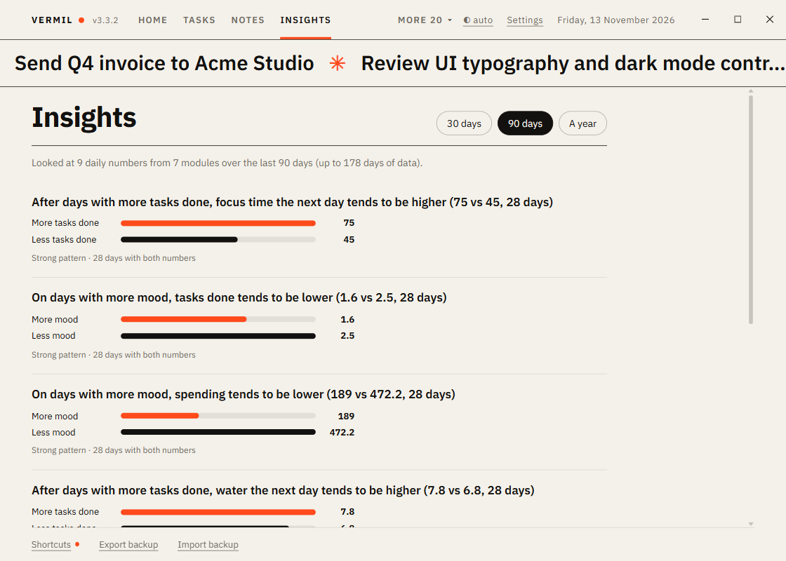

# Insights

Patterns across your modules, found for you: "on days with more sleep, your mood tends to be higher", "after days with more tasks done, your spending is lower". Everything is worked out on your computer from your own data; nothing is sent anywhere and nothing is stored.

## What it looks at

One number per day from each module you have on that keeps one: tasks done, focus minutes, money spent, hours tracked, habits kept (share of the day's habits), sleep, water, workout minutes and journal mood. It needs **at least two modules** and about **three weeks** of data to say anything.

For each pair from different modules it checks two timings, the same day and today against tomorrow, and shows only a clear link: at least 21 days with both numbers and a pattern that is unlikely to be chance. Each finding shows the average of the second number on days with more and with less of the first, how strong the pattern is (Mild, Moderate, Strong) and how many days it rests on, strongest first, at most eight.

Choose **30 days**, **90 days** or **A year** to look back. A short window reacts to recent changes; a long one is steadier.

## How to read it

These are **patterns, not causes**. More sleep may go with a better mood without being the reason, something else may drive both, and with many pairs checked, an occasional pattern is chance. Use them to ask a question, not to conclude. "No clear pattern yet" is a normal answer early on, and also a true one when things are simply not linked.

Days with no entry count as nothing happened for counts (tasks, spending, focus, workouts) and are left out for ratings (sleep, mood, water, habits), so log those on the days you can.

A module that keeps a daily number adds a `daily()` method; see [AGENTS.md](../AGENTS.md).
