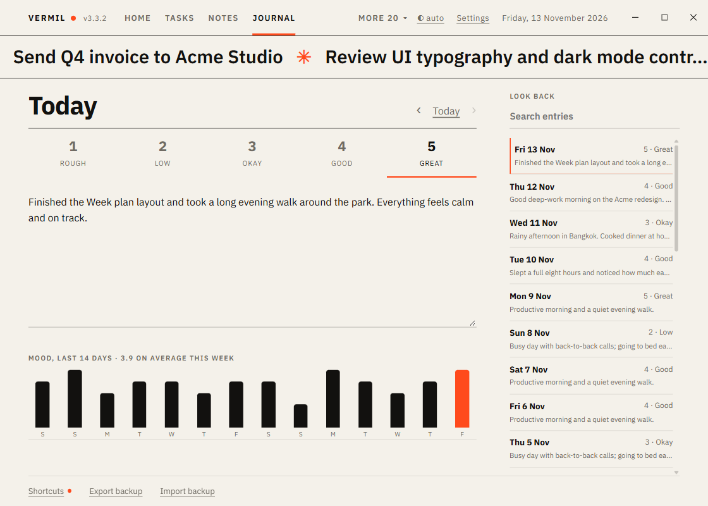

# Journal

A few lines about the day and how it felt.

## Write

Open the Journal; it starts on **Today**. Press a **mood** from 1 (Rough) to 5 (Great), then write. The text **saves itself** half a second after you stop typing, when you change day, when the window loses focus, and when the module is removed. Pressing the same mood again clears it. Clearing the text and the mood removes the day.

`‹` `›` (or `←` `→`) move between days, `Today` (or `T`) comes back; you cannot write in the future.

## Look back

- **Mood chart**: the last 14 days as columns (today in accent), with the average over the last week in the heading.
- **Look back** (right): every entry, newest first, with its mood and first line; the search box finds text. Click an entry to open it.

Keys: `N` write, `1`–`5` set the mood, `←` `→` day, `T` today.

Works with: Home tile (written today, and the week's mood), [Goals](Goals.md) (days written this month), [Weekly Review](Weekly-Review.md) (days written and average mood).
