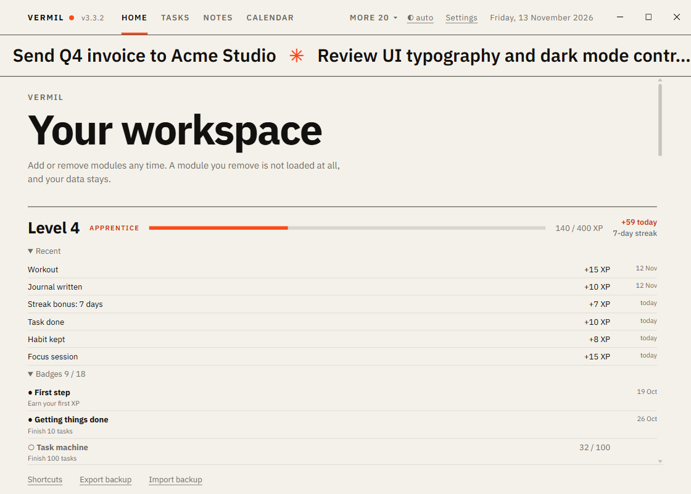

# Levels

XP and levels for what you do, like in a game. Part of the **Smart** package on Home. It adds one band to Home and a short message at each level; it has no page of its own.

## The band

On Home, above the Today numbers: **Level 3 · Apprentice**, a thin bar to the next level, "40 / 300 XP" and "+38 today". **Recent** lists the last eight things that paid XP.

Level L starts at 50 × L × (L − 1) XP: level 2 at 100, 3 at 300, 4 at 600, 5 at 1,000, 10 at 4,500. The title grows with the level: Beginner, Apprentice (3), Regular (5), Skilled (8), Expert (12), Master (18), Legend (25).

When you reach a level, a message appears for a few seconds ("Level 4 · Apprentice, 120 XP to level 5"; click it to close). If the window is hidden, a desktop notification says it too, unless that module is muted in [Settings](Settings.md).

## What pays

| What | XP | Most a day |
|---|---|---|
| A task done | 10 | 200 |
| A habit kept | 8 | 80 |
| A focus session | 15 | 90 |
| Work tracked in [Time Tracker](Time-Tracker.md) (1 XP per 10 minutes, under 5 minutes pays nothing, 30 at most per entry) | 1 to 30 | 60 |
| A journal day written | 10 | 10 |
| Spending recorded | 3 | 15 |
| A workout | 15 | 30 |
| The water goal reached | 5 | 5 |
| A bill paid | 10 | 30 |

Only modules that are switched on can pay. **Each thing counts once**: undoing a task and doing it again, or ticking a habit twice, pays nothing more. **Each source has a daily limit**, so a hundred small entries cannot run the level up. While Levels is off nothing is counted; what you earned is kept.

## Streak

Earn XP on days in a row and the band says "5-day streak". The first XP of each day, once the streak is 3 days or more, adds a **streak bonus** equal to the streak length (at most 10). A day without XP ends the streak, but yesterday's streak stays alive until today is over, so you can still save it. The longest streak is kept for the badges.

## Badges

Under **Badges** on Home, 18 goals along the way: first XP, 10 / 100 / 500 tasks, 30 / 200 habits kept, 10 focus sessions, 10 and 100 hours of tracked work, 7 and 30 journal days, 10 workouts, 10 bills paid, streaks of 3, 7 and 30 days, and levels 5 and 10. A locked badge shows how far you are ("9 / 10"); an unlocked one shows the day you got it. A new badge shows a short message like a level does. Counting starts when you update: what you did before Levels learned about badges is not counted.

## Settings

Settings has a **Levels** section with your level and XP, and **Start again from level 1** (it asks first).

XP is part of your data: it is in backups, exports and sync like every other module.
