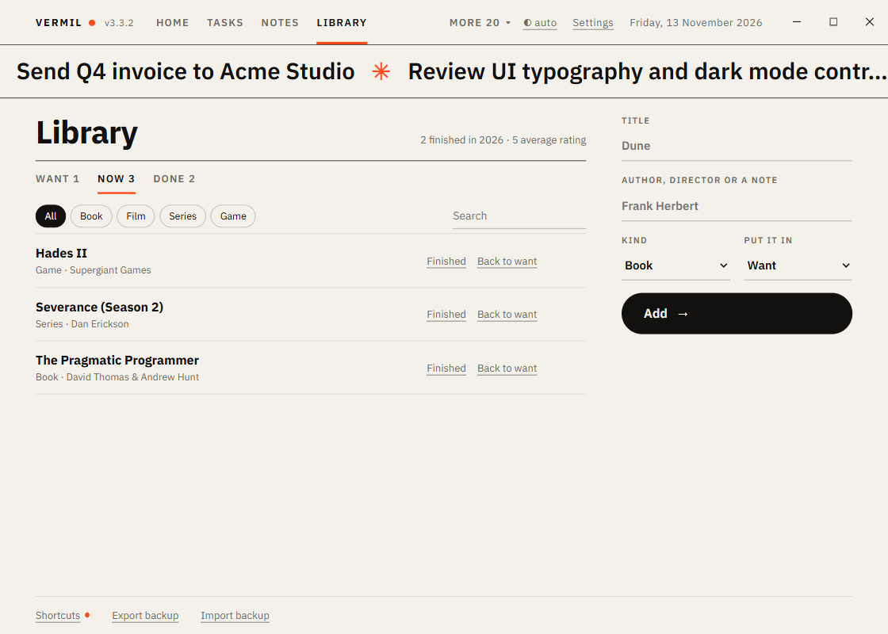

# Library

Books, films, series and games: what you want, what you are in the middle of, what you finished and how you rated it.

## Add

On the right: **Title**, **Author, director or a note**, **Kind** (Book, Film, Series, Game) and which stage to **put it in**. Press **Add**.

## Three stages

Tabs with counts: **Want**, **Now**, **Done**. Each row has the action for its stage:

- Want → **Start** (moves it to Now).
- Now → **Finished** (moves it to Done and stamps today) or **Back to want**.
- Done → **Read again** (back to Now; the rating is cleared).

On a finished item, tap the **stars** (1 to 5) to rate; tap the same star again to clear. The heading shows how many you finished this year and the average rating.

The kind chips filter the list; the search box also reads the author or note. **✕** removes an item (it asks first).

## Keys

`N` add a title, `/` search, `1` `2` `3` switch stage.

Works with: Home tile (what you are in the middle of), [Goals](Goals.md) ("Read 12 books": items and books finished this year), [Weekly Review](Weekly-Review.md).
