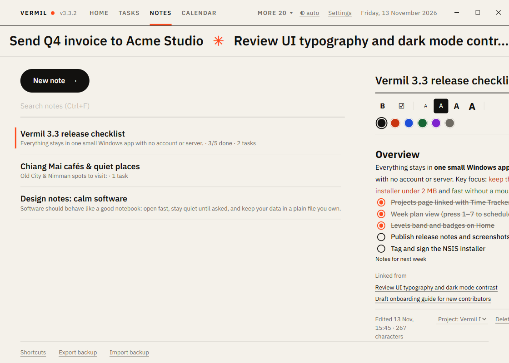

# Notes

Quick notes with a little formatting, kept light on purpose. A list on the left, the editor on the right.

## Write

`Ctrl+N` (or the New note button) starts a note: a title, then the text. It **saves itself** half a second after you stop typing, and when you switch notes, change tab or leave the window. The list shows the newest edit first with the first line.

The toolbar:

- **Four sizes**: small, normal, heading, title (the four **A** buttons).
- **Bold** (`Ctrl+B`) and **six colours** (default, vermilion, blue, green, purple, gray). Colours adapt to light and dark.
- **Checklist** (the ☑ button, or `Ctrl+Shift+L`).

Pasting always pastes plain text, so a note never drags in formatting from a web page.

## Checklists

Turn lines into a checklist with ☑ (select several lines to do them together).

- Click the **circle**, or press `Ctrl+Enter` on the item, to tick it.
- **Enter ends the list** and carries on in plain text. To add another item, type the line and press ☑ again; it joins the list above.
- The note list shows progress ("2/5 done"); a task that links to the note shows the items as `[ ]` and `[x]` lines.

## Search and delete

`Ctrl+F` searches titles and text. Arrow keys walk the list; `Delete` on a row removes that note after asking. Tasks that were linked to it keep going without it.

## Link to tasks

In [Tasks](Tasks.md), the **Linked note** menu on the form picks a note, or **New note…** creates one named after the task and opens it. Under a note, "Linked from" lists the tasks that point to it; click one to jump there. One note can serve many tasks.

Also: [`Ctrl+Alt+N`](Quick-bar.md) saves a one-line note or a link from any program.
