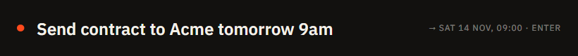

# Quick bar

A small dark bar that opens from **any program** so you can capture something without switching windows.

## Add a task: `Ctrl+Alt+T`

Type the task and press `Enter`. The bar closes by itself (or press `Esc`, or click elsewhere).

- **Dates as words** at the end of the text: "Call supplier tomorrow 9am", "Report friday 14:00", "Dentist 25/12". A preview shows what it understood, for example `→ Fri 13 Nov, 09:00`. Thai works too: "พรุ่งนี้", "วันศุกร์".
- `Ctrl+Alt+J` shows a date field instead, filled with the next full hour, when you would rather pick it. In that case the title is saved exactly as typed.
- A task added with a time reminds you at that time.

## Jot a note or a link: `Ctrl+Alt+N`

The same bar in note mode. Type a line or paste a link and press `Enter`; it is saved to [Notes](Notes.md). A bare link is titled by its site (`example.com`) and keeps the address as the note; plain text becomes the title. `Ctrl+Alt+N` inside the bar switches between task and note.

The tray menu has **Quick add** and **Quick note** too. If another program owns the shortcut, use the tray.
