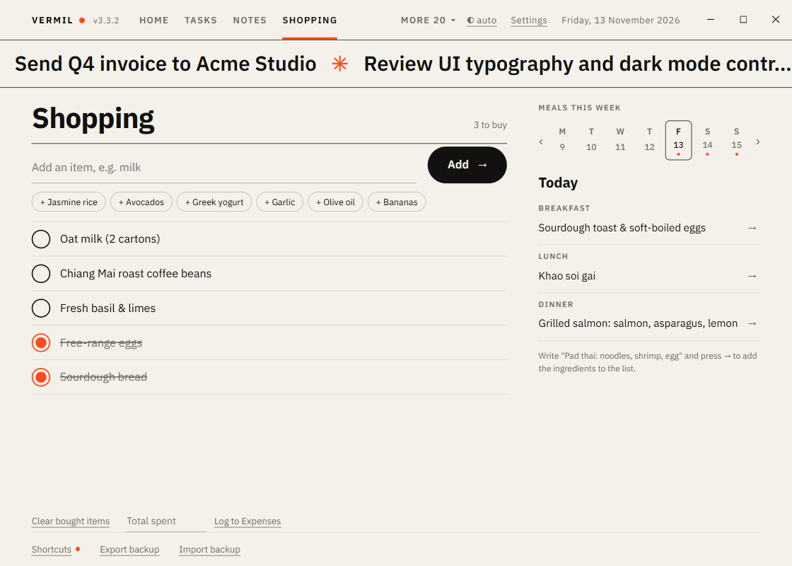

# Shopping & Meals

A shopping list that remembers what you usually buy, and a meal plan for the week.

## Shopping list

Type an item and press `Enter`. The same item (in any capitalisation) is not added twice.

- **Tick** an item when you have bought it; it moves to the bottom, struck through. **Clear bought items** removes them.
- **One-tap chips** under the field show what you add most often (not what is already on the list); tap to add again.
- **Log to Expenses**: when you have ticked things, type the **total spent** and press the link; with [Expenses](Expenses.md) on, it records the amount under **Food**, noted "Shopping", dated today.

## Meal plan

On the right: the week as seven days (a dot marks planned days), `‹` `›` for other weeks. For the selected day write **Breakfast**, **Lunch** and **Dinner**.

- Write a dish with its ingredients — `Pad thai: noodles, shrimp, egg` or `Omelette (egg, cheese)` — and press the **→** beside it: the ingredients are added to the shopping list (it tells you how many; ones already there are skipped).
- Emptying every meal of a day removes the day.

Key: `N` focuses the item field. Home shows tonight's dinner and how long the list is; [Weekly Review](Weekly-Review.md) counts items bought and meals planned.
