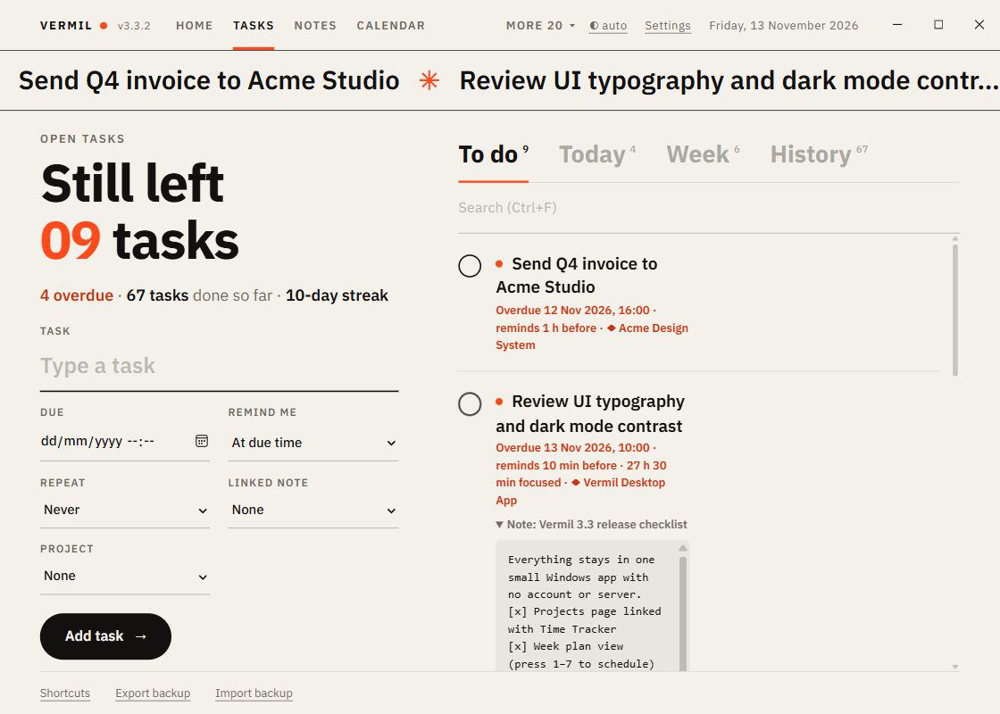
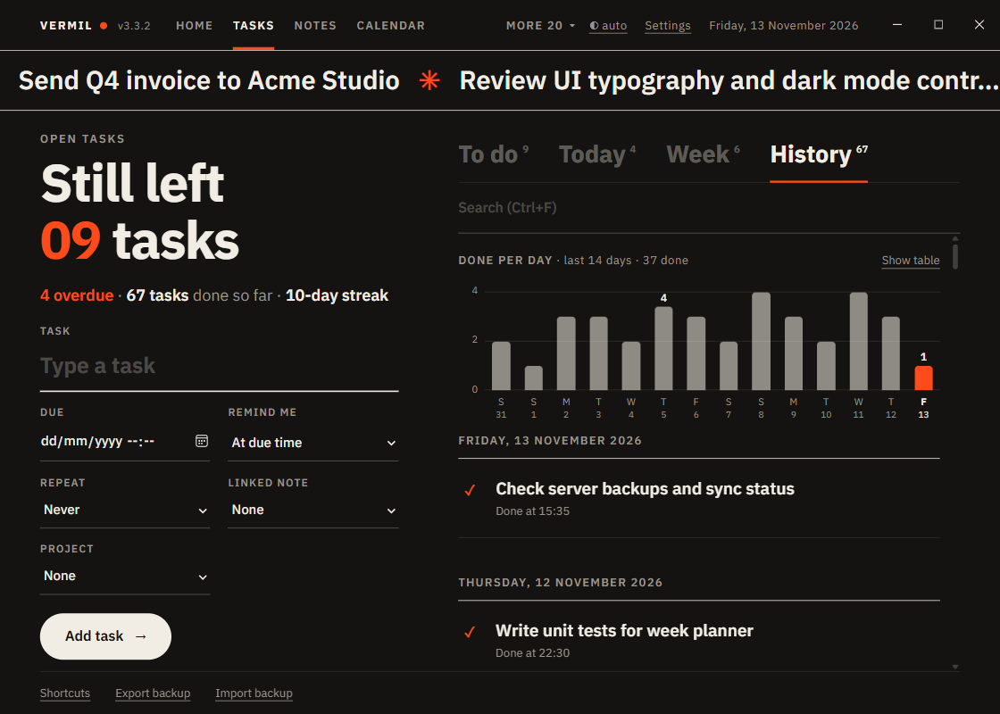

# Tasks

A to-do list with due dates, reminders, repeats, history and stats. Add it from Home. Other modules build on it (Calendar, Focus timer, Time Tracker's task suggestions).

## Add a task

Left side: type the **Task**, optionally a **Due** date and time, **Remind me** (at the due time, 10 minutes, 1 hour or 1 day before, or never), **Repeat** (never, every day, weekdays, every week, every month) and a **Linked note** (see [Notes](Notes.md)). Press **Add task**. Or capture one from anywhere with [`Ctrl+Alt+T`](Quick-bar.md).

## The list

Tabs on the right: **To do**, **Today** (overdue and due today), **Week** (overdue and the next 7 days) and **History**, each with a count. Search filters whatever tab you are on.

Each row: tick the circle to finish it. Hover for **Pin** (pinned tasks go first), **Edit** and **Delete** (it asks first). Overdue tasks are marked.

- **Repeating tasks**: choosing a **Repeat** turns the Due field into a **Time of day** (it comes back every day, week or month, so only the time matters). The first one is today at that time if it is still ahead, otherwise the next day; the reminder fires at that time each day. Editing a repeating task changes its time and keeps its day. Finishing one leaves a fresh copy for the next day, and the finished one shows as "Back tomorrow". Daily and weekday tasks count a **streak**.
- **History** holds what you finished, newest first; restore a task from there. Above it, a 14-day chart of how many you finished each day (a table view of the same numbers is one click away).

- A task with a **linked note** shows it under the row, with Copy and Open.
- **Undo**: `Ctrl+Z` brings back a deleted or changed task.

The big headline counts what is still open, and the scrolling banner at the top runs your open tasks.

## Reminders

A notification appears at the reminder time with **10 min**, **1 hour** and **Tomorrow** snooze buttons. Reminders work while Vermil is running (it starts with Windows and lives in the tray). With **Morning summary at** (footer) you get one notification a day with what is due.

## Keys

| Key | Does |
|---|---|
| `↑` `↓` | Select a task |
| `Space` | Done (in History: restore) |
| `E` | Edit |
| `P` | Pin or unpin |
| `O` | Open its linked note |
| `Delete` | Delete |
| `N` | New task (focus the title) |
| `1` to `4` | To do, Today, Week, History |
| `Ctrl+F` | Search |
| `Ctrl+Z` | Undo |
| `T` | Theme |
| `F` | Focus timer (if on) |
| `K` | Track time on the task (if Time is on) |

Works with: [Calendar](Calendar.md), [Focus timer](Focus-timer.md), [Notes](Notes.md), [Goals](Goals.md) (tasks done), [Time Tracker](Time-Tracker.md).
