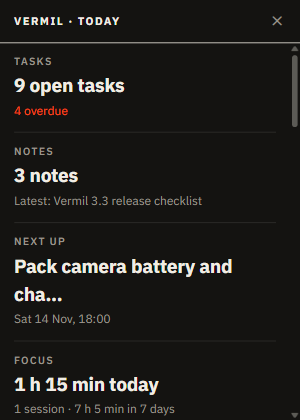

# Today widget

A small frameless window that stays on top of your other programs with today's numbers, so you do not have to open Vermil to see them.

## Use it

1. Add **Today widget** on Home. The window appears in the top right of the screen.
2. It shows the same tiles as the strip on Home: open and overdue tasks, focus, spending, your stocks, renewals, habits and whatever else you have on. An overdue count or a down day is drawn as a warning.
3. **Click a tile** to bring Vermil up on that module.
4. Drag the top edge to move it; it keeps its place while Vermil is running.
5. **✕** or `Esc` hides it. `Ctrl+Alt+W` (from any program) or **Today widget** in the tray menu shows or hides it again.

It updates every few seconds and whenever you change something in Vermil. Switching the module off hides it. If the shortcut is taken by another program, use the tray menu.

Needs at least one other module that has something to show; with none it says so.
