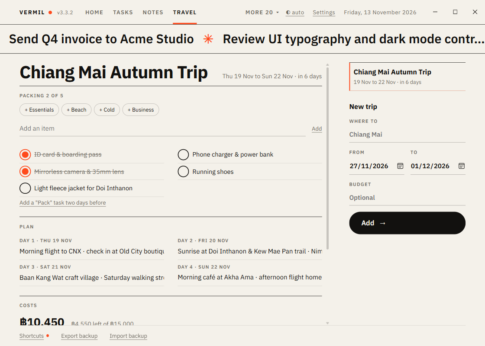

# Travel

Trips with a packing list, a plan for each day and what it costs against your budget.

## Add a trip

On the right: **Where to**, **From** and **To** dates (the end cannot be before the start) and an optional **Budget**. The trips are listed soonest first, past ones last, with "in 10 days" or "day 2 of 4" while you are away. Click one to open it.

## A trip

- **Packing**: start from a list (**+ Essentials**, **+ Beach**, **+ Cold**, **+ Business**) and/or add your own items. Tick things off ("2 of 7"); **✕** removes one. Adding a starter list twice adds nothing new. When [Tasks](Tasks.md) is on, **Add a "Pack" task two days before** creates a task for it.
- **Plan**: one line for each day of the trip ("Fly, hotel, night market"). Saved when you leave the box.
- **Costs**: add what things cost (Flights, Hotel…). The total shows against the budget: "฿2,000 left of ฿20,000", or in accent "฿1,000 over a budget of ฿20,000", with a bar. The symbol is the one set in [Expenses](Expenses.md).
- **Delete trip** removes it (it asks).

Key: `N` starts a new trip. Home shows the next trip, its countdown and how much is packed; [Weekly Review](Weekly-Review.md) lists trips in the next 30 days.

Tip: to turn a price into your own currency, type it in the [palette](Command-palette.md): `100 usd to thb`.
