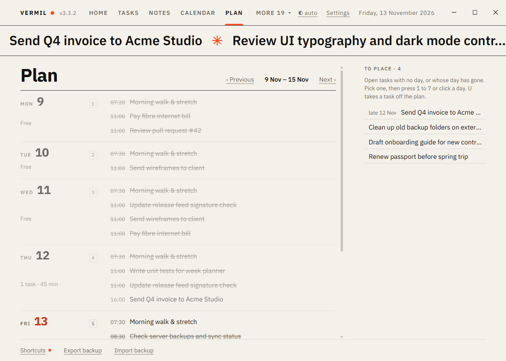

# Week plan

Plan the week on one page. Part of the **Plan** package on Home; it needs [Tasks](Tasks.md) and shows the [Calendar](Calendar.md)'s dated things too when that is on. Adds a **Plan** tab.

## The page

Seven rows, one per day of the week (the week starts on the day set in [Settings](Settings.md)), each with its tasks (with their time), the dates other modules bring (bills, events, renewals, marked ◆), and a line saying how much is on it: "3 tasks · 1 h 30 min" (the length comes from tasks that have one in the Calendar's day view), or "Free". Today's number is in the accent and past days are dimmed. A repeating task shows on every day it comes back; it keeps its own rhythm, so it can only be changed in Tasks.

On the right, **To place**: the open tasks that have no day, and those whose day has already gone (marked "late"), pinned ones first.

## Put a task on a day

1. Pick a task: click it, or `↑` `↓` to walk the tasks, or Tab to it.
2. Press **1** to **7** (Monday to Sunday, or whatever the first day of your week is) or click the day.

The task takes that day and keeps its time of day; a task with no time gets 09:00 and your usual reminder. Press a different digit to move it again. **U** takes the task off the plan (no day, back in To place).

`PageUp` / `PageDown` go to the previous or next week, `T` or **This week** comes back. Plan is the same data as the Calendar and Tasks: what you put on a day shows there at once, and `Ctrl+Z` undoes a move.

The command palette has "Plan the week". Home shows how many tasks are waiting to be placed.
