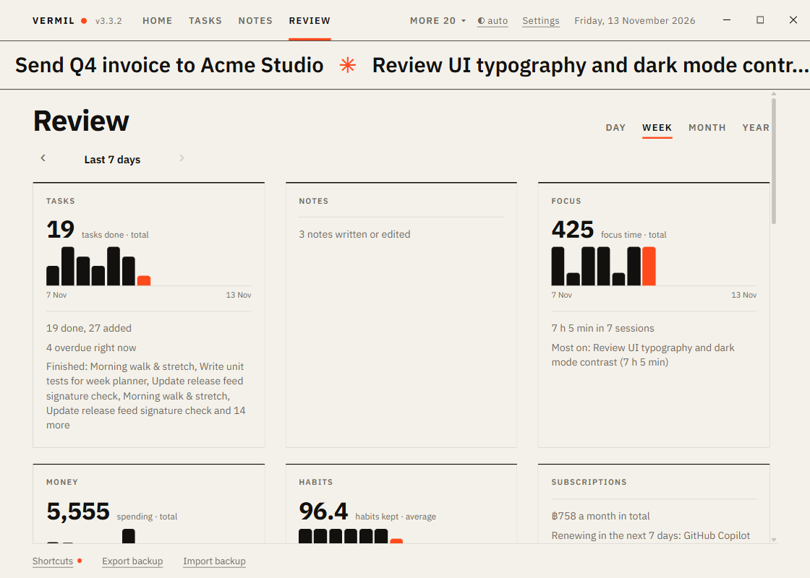

# Review

A dashboard of your day, week, month or year, built from every module you have on. (The file is still called Weekly-Review so old links work.)

## Read it

Open the **Review** tab and choose **Day**, **Week**, **Month** or **Year**. `‹` and `›` (or `←` `→`) move to the period before or after; `›` is off on the current one. Keys: `D` `W` `M` `Y` pick the period and `C` copies.

- **Day**: today, yesterday and so on, one number for the day.
- **Week**: the last 7 days (or the 7 before, and so on).
- **Month**: a calendar month, up to today for the current one.
- **Year**: a calendar year, with a bar for each month.

You get one **card** per module that has something to say, in the order of the modules. A card has up to three **big numbers**, each with a small **chart** (one thin bar per day, or per month in a year; today is in the accent colour; hover a bar for its value), and under them the module's summary lines:

- **Counts add up**: tasks done, focus time, money spent, workout minutes, hours tracked. A day with nothing counts as 0.
- **Ratings average**: mood, sleep, water, habits kept. A day with no entry is a gap, not a zero.
- Other modules (Notes, Library, People, Goals, Stocks, Travel…) show their lines only.

Switching a module off removes its card; a module that fails to report is skipped.

## Take it with you

- **Copy as text** puts the summary lines on the clipboard.
- **Save as file** writes a Markdown file in Downloads (`Vermil review-<date>.md`).
- **Save as PDF** makes the PDF straight away and puts it in Downloads (`Vermil review-<date>.pdf`), with no print dialog. It is an A4 document: the Vermil logo at the top left of every page, the title and period on the first page, the cards in two columns with their charts (never split across pages), and the page number at the bottom right. It is always black on white, whatever theme or accent colour you use, and has no browser date or title line.
- **Print…** opens the print dialog for paper (or its own Save as PDF). The page there has the same layout; the dialog's **Headers and footers** option adds the browser's date and title, so switch it off if you do not want them.
